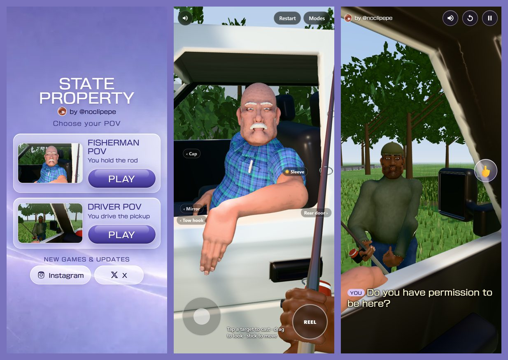

# STATE PROPERTY

Two playable perspectives on the State Property meme, in the browser. Built for desktop and mobile.



## The games

- **Fisherman POV**: you stand at the pickup's open window with a fishing rod while the driver
  tells you off. Cast at his mirror, his cap or his sleeve, or hook the truck itself and drag it
  across the lawn.
- **Driver POV**: you are the man in the pickup. Pick what to say to the fisherman. The right
  answers replay the original conversation with the original voices; then he hooks your truck
  and hauls it toward the pond, with you still inside.

Both start from one menu (`index.html`, "Choose your POV").

## Controls

**Fisherman POV**

| | Desktop | Mobile |
|---|---|---|
| Look around | drag with the mouse | drag an empty area |
| Move | WASD / arrow keys | left stick |
| Cast | click a highlighted target | tap a target |
| Reel in | hold **Space** or **REEL** | hold **REEL** |
| Release the hook | **X** / **Q** | **Release** |
| Restart / mute | **R** / **M** | buttons at the top |
| Truck Showcase, Record Mode | **T**, or Modes | Modes |

**Driver POV**

| | Desktop | Mobile |
|---|---|---|
| Look around (always, even while people talk) | drag, or arrow keys / WASD | drag on the scene |
| Answer | click a line, or **1** / **2** / **3** | tap a line |
| Show him the finger | **F** or 🖕 | 🖕 |
| Pause / menu | **Esc** / **P** | pause button |
| Restart / mute | **R** / **M** | buttons at the top |
| Hide the top bar for recording | **H**, or add `?clean` to the address | `?clean` |

## Run it locally

Requires Node.js 22.2 or newer. three.js is included in `vendor/`, so playing needs no packages.

```bash
npm ci          # development tools only (mesh bakers, browser tests)
npm start       # static server; open the address it prints
```

Modules and assets need to be served over HTTP; opening the HTML files directly from disk won't
work.

## Build

```bash
npm run build   # -> dist/ (the menu and both game pages, ready to host as static files)
```

The build copies only what the pages use, packs the meshes, fills in share metadata and creator
links from `src/site-config.js`, and checks that every file is under 25 MiB. To test the build
locally, run `npm run serve:dist` and open the printed address.

Cloudflare Pages settings: framework preset **None**, build command `npm run build`, build output
directory `dist`, root directory left empty (the repository root).

## Project notes

- `src/site-config.js` holds everything public-facing: the games in the menu, creator links,
  the public site address used for share previews, and an optional analytics adapter (off by
  default; no data is collected). To add a game, add an entry to `SITE.games`.
- `tools/bake-*.mjs` regenerate the meshes (`npm run bake`). The `verify-*` scripts and
  `check.mjs` are browser tests (Playwright; `npx playwright install chromium` first).
- See [ATTRIBUTION.md](ATTRIBUTION.md) for third-party code, the font and asset provenance.

No open-source license is granted for this project's own code, art or branding. Third-party
components keep their own licenses (see ATTRIBUTION.md).

## Created by @noclipepe

- Instagram: [instagram.com/noclipepe](https://www.instagram.com/noclipepe/)
- X: [x.com/noclipepe](https://x.com/noclipepe)
