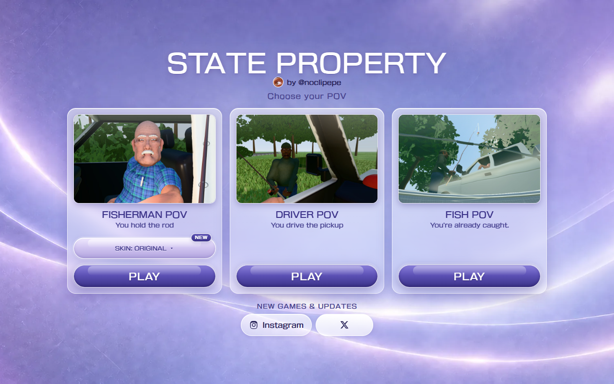

# STATE PROPERTY

[](https://state-property.pages.dev/)

Three playable perspectives on the State Property meme, in the browser. Built for desktop and mobile.



## The games

- **Fisherman POV**: you stand at the pickup's open window with a fishing rod while the driver
  tells you off. Cast at his mirror, his cap or his sleeve, or hook the truck itself and drag it
  across the lawn.
- **Driver POV**: you are the man in the pickup. Pick what to say to the fisherman. The right
  answers replay the original conversation with the original voices; then he hooks your truck
  and hauls it toward the pond, with you still inside.

- **Fish POV**: you are a caught fish inside a metal bucket. Listen to the full original
  argument, swim around, surface to hear clearly, and splash. The pickup eventually knocks
  the bucket over, spilling the water and fish onto the bank for a brief ending.

All three start from one menu (`index.html`, "Choose your POV"). The Fisherman card has a
**SKIN: ORIGINAL / GRU** selector with a **NEW** badge. Original is the default; an explicit
selection is remembered in this browser. The selector updates a static gameplay preview
without loading a 3D scene or leaving the menu. Press PLAY to launch the selected version.
Escape, clicking outside or tabbing away dismisses the panel. Arrow keys move between options;
Enter or Space selects one. Driver POV and Fish POV keep their original characters.

The same filled bucket appears beside the pickup in the two human perspectives, with larger
fish in Fisherman POV.

### Gru skin

Gru sits in a riveted metal vehicle with an open cockpit, striped scarf and a mounted shrink
ray beside the driver's window. Take the ray, aim, and fire at the vehicle or the fish bucket.
The fishing rod is stowed before the ray enters the player's hand. Misses do nothing.

A hit shrinks the vehicle and its occupant together over 0.8 seconds, including collision
bounds, while keeping the wheels grounded. The separate bucket target shrinks with its water
and swimming fish. The ray and first-person camera stay at normal scale. Repeated hits cannot
shrink a target indefinitely; either target can be hit first.

The current voice line continues uninterrupted. Tiny Gru's higher-pitched voice follows his
position near the ground, then original recorded complaints continue for about 26 seconds.
Restart restores both targets, the mounted weapon, held items and dialogue.

`GRU_CONFIG` in `src/gameplay/gru-scene.js` sets the vehicle scale to `0.12`, bucket scale to
`0.22`, voice pitch to `1.85` and shrink duration to `0.8`. The full-size vehicle measures
5.965 x 2.184 x 2.112 world units (length x width x height), within the original pickup limits.
`fisherman.html?skin=gru&showcase` records a repeatable conversation, pickup, shot and miniature
inspection using the same interactions as manual play. Add `&clean` to hide the interface.

## Controls

**Fisherman POV**

| | Desktop | Mobile |
|---|---|---|
| Look around | drag with the mouse | drag an empty area |
| Move | WASD / arrow keys | left stick |
| Cast | click a highlighted target | tap a target |
| Reel in | hold **Space** or **REEL** | hold **REEL** |
| Release the hook | **X** / **Q** | **Release** |
| Restart / mute | **R** / **M** | buttons at the top |
| Truck Showcase, Record Mode | **T**, or Modes | Modes |

Movement and shortcuts use physical keys, including when a Russian or other keyboard layout is active.

**Gru skin:** **E / TAKE** picks up the ray; **F / Space / FIRE** fires through the reticle.
Click or tap a visible point in the scene to shoot there. Drag to aim as usual. **T** or
**Modes > Gru Showcase** starts the repeatable sequence; **TAKE CONTROL** returns to manual play.

**Driver POV**

| | Desktop | Mobile |
|---|---|---|
| Look around (always, even while people talk) | drag, or arrow keys / WASD | drag on the scene |
| Answer | click a line, or **1** / **2** / **3** | tap a line |
| Show him the finger | **F** or 🖕 | 🖕 |
| Pause / menu | **Esc** / **P** | pause button |
| Restart / mute | **R** / **M** | buttons at the top |
| Hide the top bar for recording | **H**, or add `?clean` to the address | `?clean` |

**Fish POV controls:** drag or swipe to look; use **WASD** or the left pad to swim. Hold
**Space / SURFACE** to rise and release to sink; press **F / SPLASH** to jump. **Esc**, **R**
and **M** pause, restart and mute. Loading opens the game immediately. If autoplay is blocked,
the first tap unlocks audio and starts the waiting dialogue. Speech becomes muffled underwater
and clear above the surface without restarting the clip. Subtitles and a repeatable recording
showcase are available from the pause menu; `fish.html?showcase&clean` starts a showcase with
its interface hidden. Fish POV uses the original recordings in order, with no invented speech.

## Run it locally

Requires Node.js 22.2 or newer. three.js is included in `vendor/`, so playing needs no packages.

```bash
npm ci          # development tools only (mesh bakers, browser tests)
npm start       # static server; open the address it prints
```

Modules and assets need to be served over HTTP; opening the HTML files directly from disk won't
work.

## Build

```bash
npm run build   # -> dist/ (the menu and all three game pages, ready to host as static files)
```

The build copies only what the pages use, packs the meshes, fills in share metadata and creator
links from `src/site-config.js`, and checks that every file is under 25 MiB. To test the build
locally, run `npm run serve:dist` and open the printed address.

Cloudflare Pages settings: framework preset **None**, build command `npm run build`, build output
directory `dist`, root directory left empty (the repository root).

## Project notes

- `src/site-config.js` holds everything public-facing: the games in the menu, creator links,
  the public site address (`siteUrl`, used for canonical links and share previews) and an
  optional analytics adapter (off by default; no data is collected). To add a game, add an
  entry to `SITE.games`.
- `tools/bake-*.mjs` regenerate the meshes (`npm run bake`). The `verify-*` scripts and
  `check.mjs` are browser tests (Playwright; `npx playwright install chromium` first).
- `npm run bake:gru` regenerates Gru's mesh. `npm run verify:gru` checks the production preview;
  `node tools/verify-gru-bucket.mjs` covers both shrink targets and restart. `npm run verify:hub`
  covers skin selection, persistence, keyboard/touch controls and all three POV launches.
- Menu previews are lightweight JPEGs captured from the game. With the development server
  running, `node tools/capture-previews.mjs --fisherman-skins` regenerates both Fisherman previews.
- Original reference media, local transcripts and development reports are not included in this
  repository or the production build. Browser checks include desktop and phone emulation.
- See [ATTRIBUTION.md](ATTRIBUTION.md) for third-party code, the font and asset provenance.

No open-source license is granted for this project's own code, art or branding. Third-party
components keep their own licenses (see ATTRIBUTION.md).

## Created by @noclipepe

- Instagram: [instagram.com/noclipepe](https://www.instagram.com/noclipepe/)
- X: [x.com/noclipepe](https://x.com/noclipepe)
